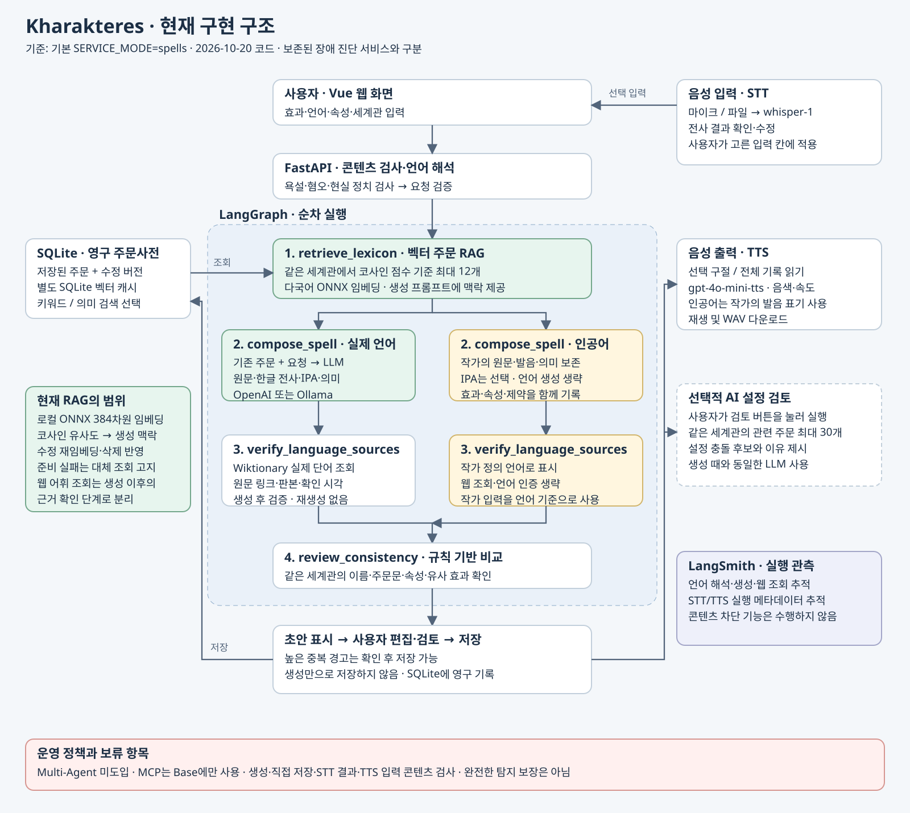

# Kharakteres · 나만의 마법 주문 웹 서비스

고대 그리스어 χαρακτῆρες에서 이름을 가져온 **다국어 마법 주문 생성·관리 및 설정 충돌 검토 AI 웹 서비스**입니다. 현대어·고전어 주문을 만들고, 창작 언어의 주문도 직접 정의해 계정별 사전에 저장할 수 있습니다. 로컬과 Docker에서 같은 가입·로그인 흐름을 제공합니다.

## 실행

```bash
cd all_total_vue_student
python3 -m venv .venv
.venv/bin/python -m pip install -r requirements.txt
cp -n .env.example .env  # 처음 준비할 때만 실행. 기존 .env가 있으면 덮어쓰지 않습니다.
# .env에 사용할 모델과 API 키 설정
bash sh/run_kharakteres.sh openai
```

기존 가상환경과 `.env`가 준비되어 있으면 마지막 실행 명령만 사용합니다. 준비 후 **http://localhost:8100** 에 접속해 처음에는 회원가입하고 이후 아이디·비밀번호로 로그인합니다. 계정별 주문사전이 분리되며 프런트엔드 서버는 따로 시작할 필요가 없습니다. 포트를 바꿀 때도 `PORT=8101 bash sh/run_kharakteres.sh openai` 하나로 실행하고 http://localhost:8101/ 에 접속합니다.

- `bash sh/run_kharakteres.sh ollama`: 로컬 Ollama로 언어 해석·생성·문맥 콘텐츠 분류
- `bash sh/run_kharakteres.sh fake`: 외부 LLM 호출 없는 데모. 콘텐츠 검사는 규칙만, 벡터 검색은 기본 비활성화
- `bash sh/run_kharakteres.sh openai --check`: 연결 상태만 확인

Docker Compose 배포는 `.env`의 모델 키와 `KHARAKTERES_SESSION_SECRET`을 설정한 뒤 `docker compose up --build -d`로 시작합니다. 기본 주소는 http://localhost:8100 이며 첫 접속에서 회원가입합니다. 계정과 사용자별 주문 DB, 임베딩 모델은 Docker 볼륨에 보존됩니다. 사전 기본값은 `wiktapi`이므로 명령 앞 환경변수 지정은 필요 없으며 명시한 셸/`.env` 설정은 유지합니다. 코드 변경 반영 후 브라우저를 새로고침합니다. 상세 절차는 [Docker·로그인·시크릿 모드 안내](all_total_vue_student/doc/DOCKER_AUTH.md)에 있습니다.

## [주요 기능]

- AI 주문 생성: 언어·속성·효과·문체·제약 조건 반영
- 언어 선택: 한국어 이름이 있는 자연어 229개를 사이트에서 가나다순으로 검색·선택
- 다국어 표현: 주문 원문·읽기용 표기·한글 발음·IPA·한국어 의미. 실제 생성 가능성과 품질은 모델·언어별로 다름
- 창작 언어: 사용자가 원문·발음·의미를 직접 정의하고 IPA는 선택 입력
- 주문사전 관리: 생성 초안 편집·저장, 직접 기록, 수정·삭제 및 JSON 내보내기
- 계정별 기록: 활성 로그인 1개·재시작 후 로그인 복원, 회원가입·로그인, 아이디 중복 확인, 가입 이메일 기반 아이디 찾기·비밀번호 재설정, 계정별 주문사전 분리
- 분류·검색: 언어·속성·계열·세계관 필터, 텍스트·의미 기반 검색
- 충돌 검토: 이름·주문문 중복 및 AI 설정 검토, 의도한 변형은 확인 후 저장
- 음성 기능: STT 음성 입력, 선택 구절·주문 항목·전체 기록의 TTS 재생
- 시크릿 모드: 임시 주문 DB·벡터 인덱스를 사용하고 종료 시 폐기, LangSmith tracing 비활성화

## [개선 포인트]

- 언어 출처 확인: 로컬·Docker 기본 WiktAPI 배포 데이터 조회 또는 명시적으로 선택한 Wiktionary 직접 조회, 제공자·판본 고정 여부·실패 상태 표시
- 벡터 RAG: 다국어 로컬 임베딩으로 관련 주문을 검색해 새 주문 생성에 반영
- 콘텐츠 필터: 욕설·혐오·현실 정치 관련 입력을 규칙과 LLM으로 검사
- 생성 과정 체계화: LangGraph로 검색·작성·출처 확인·충돌 검토 순차 구성
- 실행 추적: LangSmith로 모델·검색·필터·음성 처리 과정 관측. 시크릿 모드에서는 추적 제외
- 사용성: 반응형 서고 UI와 단계별 SSE 진행·생성 토큰 표시
- 정량 평가: 고정 데이터셋의 검색 P/R·nDCG, 충돌 F1, 블라인드 생성 채점, 반복 비교·95% 구간·원본 결과 재계산
- 배포·기록 보호: Docker Compose, 계정별 영구 저장 볼륨, 로그아웃 전까지 유지되는 영구 로그인 세션 및 임시 시크릿 저장소

사이트의 **언어 목록**에서 이름/코드·현대(209)/고전(17)/사멸(3) 분류·사전 수록 여부로 검색하고 바로 창작 언어를 선택합니다. 포함 자료 기준 229개 항목이 사전 목록과 연결되지만 개별 단어의 존재나 229개 전체의 번역 품질을 보장하지는 않습니다. 목록은 네트워크 없이도 표시하며 외부 사전 목록을 갱신할 수 있습니다. [전체 언어 목록·별칭·검증 범위](all_total_vue_student/doc/LANGUAGES.md)를 참고하세요.

## 현재 기술 구조와 도입 판단

`콘텐츠 검사 → 기존 주문 벡터 조회 → 주문 작성 → 웹 어휘 출처 확인 → 일관성 검토 → 사용자 편집·저장`

FastAPI + Vue 3 + LangGraph + SQLite 기반입니다. 가입 계정과 salted PBKDF2 비밀번호 해시는 `accounts.sqlite`에, 각 사용자의 주문과 벡터 인덱스는 `users/<id>/` 아래 별도 SQLite 파일에 저장합니다. Docker Compose는 이 데이터와 FastEmbed 모델 캐시를 영구 볼륨에 보존합니다. LLM은 OpenAI/Ollama 어댑터를 사용합니다. 벡터 검색 모델 준비 지연·오류 시 기본 조회로 대체하고 응답과 화면에 표시합니다.

**Multi-Agent는 도입하지 않았습니다.** 현재 작업 순서가 명확하고 기존 별도 AI 검토가 있어, 독립 에이전트 간 메시지·재계획을 추가할 이익보다 호출 비용·지연·복잡도가 큽니다. 역할을 나눈 함수나 STT/TTS 모델 사용을 멀티 에이전트라고 주장하지 않습니다.

**현재 Kharakteres는 MCP 서버를 사용하지 않습니다.** 웹 사전과 음성 API는 HTTP로, 주문 DB와 임베딩은 로컬 모듈로 연결합니다. 보존된 장애 진단 Base에서만 `agent/mcp_client.py`가 stdio로 `mcp_server.py`(모니터링·Runbook)와 `mcp_server_docs.py`(서비스 문서)를 연결합니다. Base는 도구·리소스 인터페이스를 분리하고 재사용하기 위해 MCP를 사용했습니다. 기본 `SERVICE_MODE=spells` 경로는 이 MCP 세션을 시작하지 않습니다.



## 설정과 한계

- 기존 `.env`를 사용합니다. 키·DB·가상환경·벡터 캐시는 Git에서 제외합니다.
- 벡터 모델 기본값은 `sentence-transformers/paraphrase-multilingual-MiniLM-L12-v2`(384차원)입니다. 처음 사용할 때 모델 파일을 내려받을 수 있습니다. 개인 주문 내용은 외부 임베딩 API에 보내지 않습니다.
- `SPELL_VECTOR_ENABLED=0`으로 벡터 조회를 끌 수 있습니다. `SPELL_RETRIEVAL_TIMEOUT_SECONDS=25`, `SPELL_RAG_MIN_SCORE=0.25`가 기본값입니다.
- `CONTENT_FILTER_MODE=model`이 실제 실행의 기본값이며, 검사 모델 오류·시간 초과·판정 형식 오류 때 요청을 중단합니다. `rules`는 알려진 표현만 검사하는 제한된 모드입니다. 필터가 모든 언어·변형·문맥을 완전히 탐지하지는 못합니다.
- 현실 정치 관련 콘텐츠는 서비스 범위에서 차단하지만, ‘정치’라는 단어 자체나 허구의 왕국 정치는 일괄 차단하지 않습니다. 기존 개인 DB 내용을 자동 삭제하지 않습니다.
- Ollama로 주문을 생성해도 **STT/TTS는 별도의 OpenAI API**를 사용하므로 API 키와 사용료가 필요합니다. fake 실행에서는 기본 비활성화됩니다.
- 실제 마이크 권한·장치는 사용자 환경에서 확인해야 합니다. 자동 브라우저 검증의 녹음기는 모의 장치입니다.

## 검증과 문서

미니 프로젝트에서 개선 효과와 한계를 설명할 수준의 정량 평가 체계를 갖췄습니다. 평가 체계를 갖춘 것과 서비스 성능이 충분히 높다는 판단은 구분합니다. 고정 데이터·정답표·동일 모델·2회 반복·블라인드 LLM 채점·95% 대응 구간을 사용하며, [정량 평가 방법](all_total_vue_student/doc/EVALUATION.md)과 [과제 기준 대조](all_total_vue_student/doc/ASSIGNMENT_REVIEW.md)에 범위를 기록했습니다.

2026-10-21 현재 자동 회귀는 **pytest 152개·SSE 클라이언트 5개**입니다. 로컬/Docker 두 브라우저의 로그인 교체, 영구 볼륨을 사용한 컨테이너 재시작 후 최신 쿠키 유지·이전 쿠키 차단을 확인했습니다. 언어 229개·가나다순·고전 통합·필터 정렬·모바일 화면·실제 3언어 사전 조회/저장도 별도 기록했습니다. 실제 모델의 소수 언어 생성 실험과 고정 데이터 핵심 함수 평가 208개는 당시 결과로 보존하며 최신 회귀 수와 구분합니다. 전체 브라우저·실제 음성 장치·전 언어 품질을 모두 검증한 것은 아닙니다. [검증 도구·결과](all_total_vue_student/eval/README.md)를 참고하세요.

| 대표 지표 | 고정 test 데이터의 결과 |
|---|---|
| 검색 Recall@3 / Precision@3 | AND 키워드 0% / 0% → 벡터 70.6% / 24.1% |
| 규칙 충돌 micro F1 | 이름만 검사 0.476 → 현재 규칙 1.000 |
| AI 의미 충돌 P/R/F1 | 0.625 / 1.000 / 0.769 — 오탐 존재 |
| 생성 LLM judge 평균(4점) | 문맥 없음 3.875 → RAG 3.854 — 향상 확인 안 됨 |

위 수치는 Kharakteres 내부의 기능 유무 대조이며 장애 진단 BASE와 직접 비교한 점수가 아닙니다. 작은 합성 세트·의역 위주 질의·무정답 1개라는 한계가 있으며, 벡터 검색은 그 무정답 사례에서 관련 없는 결과를 반환했습니다. [원본 실측 보고서](all_total_vue_student/eval/results/kharakteres-benchmark-20261021/report.md)에서 실패와 채점 이유도 함께 확인할 수 있습니다.

```bash
cd all_total_vue_student
.venv/bin/python -m pytest -q
# 실제 로컬 임베딩 + 규칙 검토 비교 (LLM 호출 없음, 새 결과 폴더 사용)
.venv/bin/python eval/kharakteres_benchmark.py --tasks retrieval conflicts --repeat 2 --output eval/results/my-evaluation
# 실제 OpenAI 생성·AI 검토·블라인드 채점 포함 (API 사용료 발생)
.venv/bin/python eval/kharakteres_benchmark.py --backend openai --tasks retrieval conflicts generation --judge --repeat 2 --max-model-calls 80 --output eval/results/my-model-evaluation
# 모델 호출 없이 원본 행에서 지표·통계·완전성 재계산
.venv/bin/python eval/audit_kharakteres_report.py eval/results/my-model-evaluation/report.json
node --test tests/test_stream_client.cjs
# Git 후보 파일 크기·큰 과거 객체·일부 키 패턴 검사 (읽기 전용)
.venv/bin/python eval/git_upload_audit.py
```

- [SSE 단계·토큰 전송과 테스트](all_total_vue_student/doc/STREAMING.md)
- [전체 기능·실행 안내](all_total_vue_student/doc/KHARAKTERES.md)
- [Kharakteres 회귀 테스트 쿼리와 기대 결과](all_total_vue_student/doc/regression_test_queries.md)
- [콘텐츠 필터·벡터 RAG·MCP 판단](all_total_vue_student/doc/SAFETY_RAG_MCP.md)
- [Git 업로드 용량과 push 안내](all_total_vue_student/doc/GIT_UPLOAD.md)
- [확장 언어 목록과 실제 지원 범위](all_total_vue_student/doc/LANGUAGES.md)
- [로컬/Docker 웹 출처 조회와 실패 대응](all_total_vue_student/doc/WEB_SOURCES.md)
- [Docker 배포·로그인·시크릿 모드](all_total_vue_student/doc/DOCKER_AUTH.md)

기존 장애 진단 코드는 보존했습니다. `SERVICE_MODE=incident`로 선택하며 해당 평가 자료는 새 주문 서비스의 기능 증거와 구분합니다.

정리 후 파일 구성과 보존한 BASE 자료는 [정리 기록](all_total_vue_student/doc/CLEANUP.md)과 [BASE 보관 안내](all_total_vue_student/archive/README.md)를 참고하세요.


로그인은 계정 DB에 보존해 브라우저·서버·Docker 재시작 후 복원하며 **새 로그인 성공 시 기존 세션을 해제**합니다. 실패한 로그인과 다른 계정은 영향을 주지 않습니다. 쿠키는 400일 수명으로 인증 응답마다 갱신하며 쿠키 삭제·서명 키 변경·비밀번호 초기화 시 재로그인이 필요합니다. 시크릿 주문은 재시작 후 복원하지 않습니다. 별도 DB로 운영하는 로컬/Docker 서버끼리는 세션을 공유하지 않습니다([로그인 정책](all_total_vue_student/doc/DOCKER_AUTH.md)).
