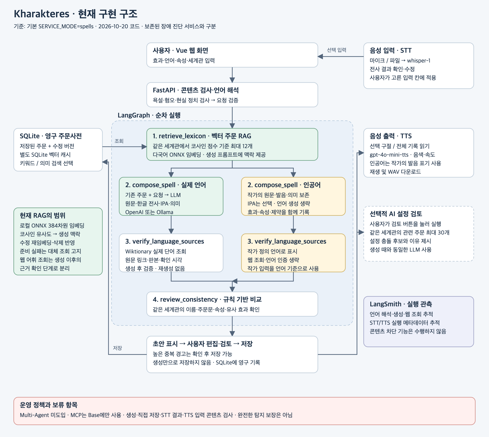

# Kharakteres · 나만의 마법 주문 웹 서비스

고대 그리스어 χαρακτῆρες에서 이름을 가져온 개인용 주문사전 AI 웹 서비스입니다. 현대어·고전어 주문을 창작하고, 자신의 인공 언어도 원문·발음·의미를 직접 정의해 저장할 수 있습니다.

## 실행

```bash
cd all_total_vue_student
python3 -m venv .venv
.venv/bin/python -m pip install -r requirements.txt
cp -n .env.example .env  # 처음 준비할 때만 실행. 기존 .env가 있으면 덮어쓰지 않습니다.
# .env에 사용할 모델과 API 키 설정
bash sh/run_kharakteres.sh openai
```

기존 가상환경과 `.env`가 준비되어 있으면 마지막 실행 명령만 사용합니다. 준비 후 **http://localhost:8100** 에 접속합니다. 프런트엔드 서버를 따로 시작할 필요가 없습니다. 포트를 바꿀 때도 `PORT=8101 bash sh/run_kharakteres.sh openai` 하나로 실행하고 http://localhost:8101/ 에 접속합니다.

- `bash sh/run_kharakteres.sh ollama`: 로컬 Ollama로 언어 해석·생성·문맥 콘텐츠 분류
- `bash sh/run_kharakteres.sh fake`: 외부 LLM 호출 없는 데모. 콘텐츠 검사는 규칙만, 벡터 검색은 기본 비활성화
- `bash sh/run_kharakteres.sh openai --check`: 연결 상태만 확인

## 주요 기능

- **언어 대화**: 채팅으로 원하는 언어를 입력하고 모호하면 추가 확인
- **다국어 주문 생성**: 원문·로마자·한글 전사·IPA·발음 관례·의미 제공
- **인공 언어**: 작가가 원문·발음·의미를 직접 입력. IPA는 선택이며 입력을 임의로 번역하지 않음
- **영구 주문사전**: SQLite 저장, 편집·삭제·수정 버전 보호·JSON 내보내기
- **의미 검색 / 벡터 RAG**: 로컬 다국어 FastEmbed 임베딩 + NumPy 코사인 검색. 생성 전 같은 세계관 주문 최대 12개를 프롬프트에 제공. 목록에서 키워드 / 의미 검색 선택
- **웹 어휘 검증**: Wiktionary 실제 단어·언어 항목과 확인 판본 링크 제공. 문장 전체의 문법이나 IPA 인증은 아님
- **설정 검토**: 규칙 기반 중복·유사성 검사, 선택적 AI 설정 검토
- **콘텐츠 필터**: 알려진 욕설·혐오·현실 정치 표현의 규칙 검사 + 실제 실행 모드의 검사 LLM 문맥 분류. 허구의 왕국·가상 선거·판타지 전투는 허용
- **STT/TTS**: AIDubsar 노트북을 참고한 녹음·파일 전사, 입력 칸 적용, 선택 구절·전체 기록 읽기, 음색·속도·WAV 다운로드
- **실시간 생성**: SSE로 단계별 진행·모델 응답 조각·중간 초안·출처·충돌 검토를 순차 표시. 생성 중단 지원
- **실행 추적**: LangGraph 단계와 LangSmith trace로 생성·검색·검사·음성 처리 확인

## 현재 기술 구조와 도입 판단

`콘텐츠 검사 → 기존 주문 벡터 조회 → 주문 작성 → 웹 어휘 출처 확인 → 일관성 검토 → 사용자 편집·저장`

FastAPI + Vue 3 + LangGraph + SQLite 기반입니다. LLM은 기존 OpenAI/Ollama 어댑터를 사용합니다. 벡터는 별도 SQLite 캐시에 저장하며 저장 내용이 바뀌면 재임베딩하고 삭제된 주문 벡터를 제거합니다. 모델 준비 지연·오류 시 기본 조회로 대체하고 응답과 화면에 표시합니다.

**Multi-Agent는 도입하지 않았습니다.** 현재 작업 순서가 명확하고 기존 별도 AI 검토가 있어, 독립 에이전트 간 메시지·재계획을 추가할 이익보다 호출 비용·지연·복잡도가 큽니다. 역할을 나눈 함수나 STT/TTS 모델 사용을 멀티 에이전트라고 주장하지 않습니다.

**현재 Kharakteres는 MCP 서버를 사용하지 않습니다.** 웹 사전과 음성 API는 HTTP로, 주문 DB와 임베딩은 로컬 모듈로 연결합니다. 보존된 장애 진단 Base에서만 `agent/mcp_client.py`가 stdio로 `mcp_server.py`(모니터링·Runbook)와 `mcp_server_docs.py`(서비스 문서)를 연결합니다. Base는 도구·리소스 인터페이스를 분리하고 재사용하기 위해 MCP를 사용했습니다. 기본 `SERVICE_MODE=spells` 경로는 이 MCP 세션을 시작하지 않습니다.



## 설정과 한계

- 기존 `.env`를 사용합니다. 키·DB·가상환경·벡터 캐시는 Git에서 제외합니다.
- 벡터 모델 기본값은 `sentence-transformers/paraphrase-multilingual-MiniLM-L12-v2`(384차원)입니다. 처음 사용할 때 모델 파일을 내려받을 수 있습니다. 개인 주문 내용은 외부 임베딩 API에 보내지 않습니다.
- `SPELL_VECTOR_ENABLED=0`으로 벡터 조회를 끌 수 있습니다. `SPELL_RETRIEVAL_TIMEOUT_SECONDS=25`, `SPELL_RAG_MIN_SCORE=0.25`가 기본값입니다.
- `CONTENT_FILTER_MODE=model`이 실제 실행의 기본값이며, 검사 모델 오류·시간 초과·판정 형식 오류 때 요청을 중단합니다. `rules`는 알려진 표현만 검사하는 제한된 모드입니다. 필터가 모든 언어·변형·문맥을 완전히 탐지하지는 못합니다.
- 현실 정치 관련 콘텐츠는 서비스 범위에서 차단하지만, ‘정치’라는 단어 자체나 허구의 왕국 정치는 일괄 차단하지 않습니다. 기존 개인 DB 내용을 자동 삭제하지 않습니다.
- Ollama로 주문을 생성해도 **STT/TTS는 별도의 OpenAI API**를 사용하므로 API 키와 사용료가 필요합니다. fake 실행에서는 기본 비활성화됩니다.
- 실제 마이크 권한·장치는 사용자 환경에서 확인해야 합니다. 자동 브라우저 검증의 녹음기는 모의 장치입니다.

## 검증과 문서

```bash
cd all_total_vue_student
.venv/bin/python -m pytest -q
.venv/bin/python eval/kharakteres_browser_smoke.py
.venv/bin/python eval/kharakteres_audio_smoke.py
.venv/bin/python eval/kharakteres_safety_rag_browser.py
# 실제 모델·ONNX 검색 검증: 구성된 모델/API 사용
LLM_BACKEND=openai .venv/bin/python eval/kharakteres_rag_live.py
# Git 후보 파일 크기·큰 과거 객체·일부 키 패턴 검사 (읽기 전용)
.venv/bin/python eval/git_upload_audit.py
```

- [SSE 단계·토큰 전송과 테스트](all_total_vue_student/doc/STREAMING.md)
- [전체 기능·실행 안내](all_total_vue_student/doc/KHARAKTERES.md)
- [Kharakteres 회귀 테스트 쿼리와 기대 결과](all_total_vue_student/doc/regression_test_queries.md)
- [콘텐츠 필터·벡터 RAG·MCP 판단](all_total_vue_student/doc/SAFETY_RAG_MCP.md)
- [Git 업로드 용량과 push 안내](all_total_vue_student/doc/GIT_UPLOAD.md)

기존 장애 진단 코드는 보존했습니다. `SERVICE_MODE=incident`로 선택하며 해당 평가 자료는 새 주문 서비스의 기능 증거와 구분합니다.

정리 후 파일 구성과 보존한 BASE 자료는 [정리 기록](all_total_vue_student/doc/CLEANUP.md)과 [BASE 보관 안내](all_total_vue_student/archive/README.md)를 참고하세요.
