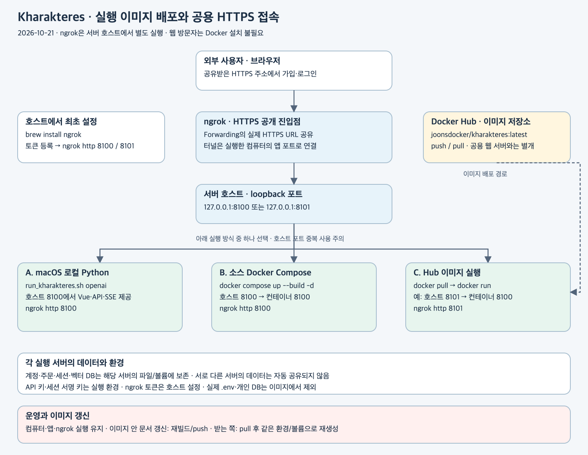

# ngrok HTTPS 주소 발급과 공유

대상 서비스는 Kharakteres이며 Docker Hub 이미지는 `joonsdocker/kharakteres:latest`입니다. 실행한 서버의 포트를 ngrok에 연결하면 외부 사용자는 브라우저만으로 접속합니다. 방문자마다 Docker를 설치하거나 이미지를 받을 필요는 없습니다.



## 실행 방식과 포트

| 서버 실행 방식 | 실행/준비 | 서버 컴퓨터의 포트 | ngrok 명령 |
|---|---|---:|---|
| macOS 로컬 Python | `bash sh/run_kharakteres.sh openai` | 기본 8100 | `ngrok http 8100` |
| 소스 폴더의 Docker Compose | `docker compose up --build -d` | 기본 8100, 변경 시 DOCKER_PORT | `ngrok http 8100` |
| Hub에서 받은 이미지 | [Hub 실행 안내](DOCKER_HUB.md)의 docker run | 예시는 8101 → 컨테이너 8100 | `ngrok http 8101` |

Docker Desktop은 macOS에서 Docker 엔진과 컨테이너를 관리하는 앱입니다. 위 CLI로 만든 컨테이너도 Desktop의 Containers에서 상태·로그·중지/시작을 확인할 수 있습니다. Desktop에서 이미지를 직접 Run할 때도 동일한 포트·환경변수·볼륨을 지정해야 합니다. 이미지 다운로드만으로 계정 데이터나 `.env`가 생기는 것은 아닙니다.

ngrok은 **컨테이너 내부 포트가 아니라 호스트에 공개한 포트**에 연결합니다. 서버와 ngrok은 같은 컴퓨터에서 실행하는 절차입니다. 다른 호스트에서 실행한다면 실제 서버로 도달하는 별도의 네트워크 경로가 필요합니다. 로컬 Python과 Docker가 8100을 동시에 차지하지 않게 한 방식만 실행하거나 포트를 나눕니다.

## 최초 준비

[ngrok 계정](https://dashboard.ngrok.com/get-started/setup)을 만들고 macOS의 서버 호스트에서 설치/인증합니다. 토큰은 본인 대시보드의 값을 사용하고 저장소·이미지·채팅에 넣지 않습니다.

```bash
brew install ngrok
ngrok config add-authtoken "본인의_ngrok_토큰"
```

이는 호스트 ngrok의 인증입니다. Kharakteres `.env`에 ngrok 토큰을 넣거나 앱 이미지에 ngrok을 설치할 필요는 없습니다([ngrok 공식 설치](https://ngrok.com/download/mac-os)).

HTTPS URL로 로그인할 때는 실행 환경의 다음 값을 설정합니다.

```dotenv
KHARAKTERES_COOKIE_SECURE=1
```

기존 `.env`의 API 키와 서명 키는 그대로 보존합니다. `.env.example`은 복사용 안내이며 실제 `.env`를 자동 갱신하지 않습니다. 로컬 앱은 서버를 재시작하고 소스 Compose는 `docker compose up -d`, `docker run`으로 만든 컨테이너는 같은 환경/볼륨으로 재생성해야 변경된 환경변수가 적용됩니다. 단순 `docker start/restart`는 생성 당시 환경을 사용합니다.

평소 HTTP 로컬 로그인만 사용할 때는 `KHARAKTERES_COOKIE_SECURE=0`이 기본입니다. HTTPS용 설정에서는 회원가입/로그인을 ngrok HTTPS 주소에서 확인합니다. localhost와 ngrok 주소의 브라우저 쿠키는 별개이므로 각 주소에서의 로그인 상태가 자동으로 공유되는 것은 아닙니다.

## 로컬 Python 또는 소스 Compose 연결

준비된 소스 폴더의 터미널 A에서 **둘 중 하나**를 실행합니다.

```bash
# Python: 서버가 실행되는 동안 터미널 유지
bash sh/run_kharakteres.sh openai
# 또는 Docker: 백그라운드 실행
# docker compose up --build -d
```

같은 컴퓨터의 터미널 B에서 준비 상태를 확인하고 터널을 엽니다.

```bash
curl http://127.0.0.1:8100/health
ngrok http 8100
```

소스 Compose는 `127.0.0.1` 바인딩을 유지해도 됩니다. 호스트 ngrok이 해당 주소에 접속하므로 `0.0.0.0` 공개, 공유기 포트포워딩, 프런트엔드 별도 서버는 필요하지 않습니다. 단, 사용 중인 네트워크가 ngrok 외부 연결을 허용해야 합니다.

ngrok 출력의 **Forwarding HTTPS 주소**를 공유합니다. 예를 들면 아래와 같은 연결 정보이며 정확한 호스트명은 자신의 실행 결과를 사용합니다.

```text
https://ngrok이-표시한-호스트 → http://localhost:8100
```

Hub 이미지를 호스트 8101로 실행했다면 `curl http://127.0.0.1:8101/health`와 `ngrok http 8101`을 사용합니다. 상세 pull·실행·볼륨·환경 설정은 [Docker Hub 안내](DOCKER_HUB.md)에 있습니다.

## Docker Desktop ngrok Extension으로 연결

호스트 터미널의 `ngrok http`와 Docker Desktop **Extensions → ngrok → Endpoints**는 연결 경로가 다릅니다. Extension v1.0.0은 Docker VM의 `172.17.0.1:<게시한 포트>`로 전달합니다([공식 구현](https://github.com/ngrok/ngrok-docker-extension/blob/main/backend/internal/manager/converge_endpoints.go)). 현재 환경에서 `127.0.0.1:8100`만 게시하면 CLI는 정상이어도 Extension 업스트림은 연결 거부됩니다.

소스 Compose에서는 실제 `.env`에 다음을 설정합니다.

```dotenv
DOCKER_BIND_ADDRESS=0.0.0.0
```

```bash
docker compose up -d --no-build kharakteres
```

이 설정은 게시한 포트에 LAN에서도 접근할 수 있도록 합니다(호스트 방화벽 설정에 따름). 호스트 CLI만 사용할 경우 기본값 `127.0.0.1`을 유지해도 됩니다. 바인딩 변경은 실행 설정이므로 이 문제 해결만을 위해 이미지를 재빌드하거나 Hub에 push할 필요는 없습니다.

Extension에서 ngrok 인증을 별도로 설정하고, **현재 실행 중인 Kharakteres 컨테이너**와 **게시한 호스트 포트**를 선택해 Public Endpoint를 시작합니다. Compose 재생성 후 컨테이너 ID가 바뀌므로 이전 ID의 Endpoint는 제거하고 새 컨테이너로 등록합니다. 호스트 포트를 8101로 바꿨다면 Target Port도 8101입니다. CLI 터널이 같은 URL을 점유 중이면 먼저 해당 CLI 터널을 종료하고 Extension을 시작합니다. 단일 앱 공유에는 Endpoint Pooling이 필요하지 않습니다.

Hub 이미지의 `docker run` 예시를 Extension과 함께 쓸 때는 `-p 127.0.0.1:8101:8100` 대신 `-p 0.0.0.0:8101:8100`을 사용해 **같은 데이터 볼륨으로 컨테이너를 재생성**합니다. `.env`의 `DOCKER_BIND_ADDRESS`만 바꿔도 수동 `docker run`의 `-p` 옵션은 자동 변경되지 않습니다. Desktop의 Run 화면에서는 Host port를 동일하게 지정합니다.

Endpoint의 Online 표시는 ngrok 클라우드 연결 상태입니다. 실제 서비스까지 확인하려면 공용 HTTPS 주소의 `/health`와 첫 화면에 접속합니다. 중지된 Endpoint의 URL은 `ERR_NGROK_3200`이 나올 수 있고, Online 상태에서 업스트림 연결 거부가 나오면 포트 바인딩부터 확인합니다.

## 접속과 유지

- 접속자는 공유한 HTTPS 주소에서 가입/로그인합니다. 계정별 주문 DB와 새 로그인 우선의 단일 세션 정책은 동일합니다. 여러 방문자가 하나의 서버/DB를 사용하는 구조이며, 각자 독립 서버를 실행한 경우 데이터는 공유되지 않습니다.
- 마이크·STT/TTS·SSE도 같은 HTTPS 서비스 주소를 사용합니다. 브라우저 마이크 권한과 모델/API 설정은 별도로 필요합니다. 사용료가 발생하는 모델 호출은 서버 운영자의 설정된 API 계정으로 처리됩니다.
- 컴퓨터·Docker 엔진(컨테이너 사용 시)·앱·ngrok을 실행 상태로 유지합니다. 잠자기/전원 종료/네트워크 단절/터널 종료 시 접속할 수 없습니다. Hub 업로드는 상시 웹 호스팅이 아닙니다.
- 터널 종료는 ngrok 터미널의 Ctrl+C입니다. 앱·데이터 볼륨을 지우지 않습니다. 다시 열고 실제 Forwarding 주소를 확인하며 주소가 바뀌었다면 새 주소를 공유합니다.
- 상시 서비스는 별도 서버의 지속 실행과 도메인·HTTPS·접근 제어·백업 운영이 필요합니다. ngrok 연결만으로 현재 이메일 일치 기반 비밀번호 복구가 보강되지는 않습니다([인증 범위](DOCKER_AUTH.md#로그인)).

## 문제 확인

| 증상 | 확인 |
|---|---|
| ngrok 업스트림 연결 오류 | 같은 컴퓨터에서 해당 포트의 `/health`부터 확인. Docker 매핑 8101:8100이면 ngrok도 8101 |
| CLI는 되지만 Desktop Extension은 실패 | [Extension 연결](#docker-desktop-ngrok-extension으로-연결)의 바인딩·게시 포트·현재 컨테이너 ID 확인 |
| 로컬 주소는 되지만 공개 URL 실패 | ngrok 실행/인증 상태, Forwarding 주소, 네트워크 정책 확인 |
| 화면은 열리지만 생성 실패 | `docker logs --tail=100 kharakteres-hub` 또는 로컬 서버 로그, 모델 키·할당량·Ollama 연결 확인 |
| 로그인 반복/유지 실패 | HTTPS에서 로그인, Secure 쿠키 설정·접속 호스트·서명 키·데이터 볼륨·다른 기기의 새 로그인 확인 |
| 마이크 사용 불가 | HTTPS 주소·브라우저 권한·실제 장치 확인. 오디오 파일 업로드도 별도로 사용 가능 |
| SSE 단계가 늦게 나타남 | 모델 시작 지연과 터널/중간 프록시 버퍼링·제한을 구분. 실제 `/api/generate/stream` 수신 확인 |

## 확인한 범위

2026-10-21 Extension 문제 점검: 바인딩 변경 전 호스트 `127.0.0.1:8100/health` 및 일반 bridge 컨테이너의 `host.docker.internal:8100/health`는 HTTP 200이었지만, Extension과 같은 host 네트워크에서 `172.17.0.1:8100/health`는 연결 거부였습니다. `DOCKER_BIND_ADDRESS=0.0.0.0` 적용과 앱 컨테이너 재생성 후 게이트웨이 경로도 HTTP 200으로 복구했습니다. 새 컨테이너 ID로 Extension Endpoint를 등록하고 오래된 Offline 항목을 제거했으며, Extension 공용 HTTPS 주소의 `/health`, `/`, `/api/auth/session` HTTP 200과 첫 화면 HTML을 직접 확인했습니다. 기존 named volume을 유지했고 실제 사용자 로그인·주문 생성·음성·SSE는 이 네트워크 점검에서 다시 실행하지 않았습니다. 이미지 재빌드나 Hub push는 하지 않았습니다.

2026-10-21 사용자 보고: macOS 로컬호스트·Docker/Docker Desktop 실행과 ngrok 공용 URL 접속, 서비스 기능 정상 사용을 확인했습니다. 이는 사용자가 실행해 확인한 결과입니다. 이번 문서 갱신에서 에이전트가 그 URL을 직접 재접속하거나 SSE·실제 마이크·전 언어를 항목별로 독립 재측정한 것은 아닙니다. 공개 URL·인증 토큰·개인 계정 데이터는 문서에 기록하지 않습니다.

[검증 범위](../eval/README.md)와 [사용자 확인 기록](../eval/results/kharakteres-ngrok-user-report-20261021.json)을 참고하세요.
