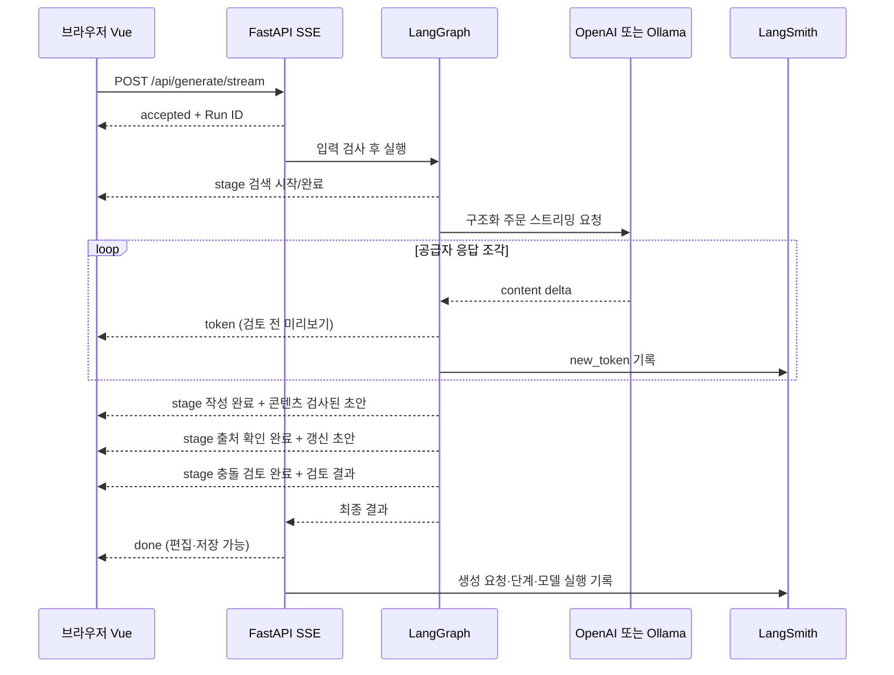

# SSE 실시간 주문 생성

Kharakteres는 화면·API·SSE를 같은 FastAPI 서버에서 제공합니다. 프런트엔드 서버를 별도 포트에서 실행하지 않습니다.

## 사용

```bash
bash sh/run_kharakteres.sh openai
# 또는
bash sh/run_kharakteres.sh ollama
```

http://localhost:8100/ 에서 새 주문을 생성합니다. 실행 중인 이전 서버가 있으면 해당 터미널에서 Ctrl+C 후 다시 실행하고 브라우저를 새로고침하세요.

1. 요청 내용 확인
2. 기존 주문 검색 — 참고 주문 수, 벡터 RAG/대체 조회 표시
3. 주문 작성·콘텐츠 검사 — 모델 응답에 맞춰 이름·주문문·발음·의미·효과 미리보기
4. 언어·발음 출처 확인 — 검사된 초안 표시 후 웹 어휘 조회 결과 반영
5. 기존 주문과 충돌 검토 — 검토 결과 반영 후 편집·저장·TTS 활성화

출처 조회의 이름은 언어·발음 출처 확인이지만 실제 범위는 Wiktionary 단어·언어 항목과 제공되는 단어 IPA 참고입니다. 문장 전체의 문법·의미·한글 전사·IPA를 인증하지 않습니다.

작성 중 미리보기와 검사 완료 초안은 구분됩니다. 생성만으로 주문을 저장하지 않습니다. 생성 중단·콘텐츠 차단·잘못된 형식·연결 끊김은 미완성 결과를 지우며 자동으로 유료 요청을 반복하지 않습니다.

## 구조



브라우저는 POST와 취소를 지원하기 위해 `fetch`의 응답 스트림을 사용합니다. `EventSource`의 GET 자동 재연결로 생성 요청이 반복되지 않습니다. 기존 `POST /api/generate` JSON API도 같은 그래프와 검사를 사용합니다.

## 이벤트

| 이벤트 | 의미 |
|---|---|
| `accepted` | 요청별 단계 목록, LangSmith Run ID, 실제 토큰 생성 여부 |
| `stage` | 단계 시작/완료. 완료 시 참고 주문 수·검사된 초안·출처·충돌 결과를 필요한 범위로 전달 |
| `token` | 작성 모델이 실제로 내보낸 응답 조각. 한 조각이 토큰 여러 개일 수 있음 |
| `done` | 검사를 통과한 전체 최종 결과. 이 이벤트 없이는 성공으로 처리하지 않음 |
| `error` | 코드·사용자 메시지·미리보기 제거 표시. 공급자 오류 원문과 API 키를 노출하지 않음 |
| SSE 주석 `heartbeat` | 이벤트가 없는 동안 5초마다 연결 유지. 단계 진행을 꾸며내지 않음 |

요청 스키마 오류는 연결 전 HTTP 422, 스트림 시작 이후 오류는 `error` 이벤트입니다. 요청별 ContextVar와 크기 제한 큐(64개)로 동시 요청을 분리하고 느린 수신자의 토큰이 무제한 쌓이지 않게 합니다. 연결 종료 시 작업을 취소하고 비동기 공급자 HTTP 응답을 닫습니다. 이미 시작한 원격 생성의 청구나 기존 동기 검사 모델 스레드까지 즉시 중단된다고 보장하지는 않습니다.

fake와 인공 언어 경로에는 생성 모델 토큰이 없으므로 단계만 전송합니다. 인공 언어의 작가 입력·IPA 선택은 유지합니다. 내부 추론/생각 토큰은 전송하지 않습니다.

## 콘텐츠 검사와 추적 범위

입력·RAG 맥락·완성 주문·웹 출처에 대한 기존 검사를 유지합니다. 토큰 미리보기는 누적 출력의 알려진 차단 표현을 규칙으로 검사합니다. 조각 경계·Unicode 이스케이프를 처리하지만 전체 문맥 LLM 검사는 출력이 완성된 뒤 수행하므로 미리보기 전체가 사전 승인된 콘텐츠는 아닙니다. 실패하면 화면에서 제거하며 저장을 허용하지 않습니다. 렌더링은 Vue 텍스트 출력이며 사용자 내용을 HTML로 실행하지 않습니다.

LangSmith 추적을 활성화하면 `kharakteres.generate_stream_request` 아래의 그래프·모델·검사를 확인할 수 있습니다. 화면의 Run ID로 찾고 `spell.language_model`의 `new_token` 이벤트를 확인합니다. 이벤트는 SDK의 전송·반영 지연이 있을 수 있으며 LangSmith 화면이 브라우저와 동시에 갱신된다고 보장하지 않습니다. 추적 비활성 시 Run ID가 없고 SSE 자체는 정상 동작합니다.

## 검증

```bash
.venv/bin/python -m pytest -q
node --test tests/test_stream_client.cjs
.venv/bin/python eval/kharakteres_stream_smoke.py
# 실제 모델·네트워크·LangSmith 사용 (OpenAI API 사용료 가능)
.venv/bin/python eval/kharakteres_stream_live.py openai
.venv/bin/python eval/kharakteres_stream_live.py ollama
```

- pytest 94개, JavaScript 스트림 파서 4개 통과
- 브라우저: 완료 전 필드 표시, 단계별 갱신, 완료 전 저장 차단, 생성 중단, 연결 끊김, 모바일 확인
- 모의 공급자 검증은 지연된 응답을 사용한 제어 흐름 검사이며 실제 LLM 성능 측정이 아님
- 실제 OpenAI(gpt-4o): 응답 조각 251개, 첫 토큰 약 1.80초, 완료 약 7.30초
- 실제 Ollama(qwen3:8b): 응답 조각 276개, 첫 토큰 약 10.13초, 완료 약 31.85초
- 두 실제 요청 모두 SSE 조각 수와 LangSmith `new_token` 수 일치. 5개 단계 완료 및 최종 형식 일치 확인

위 시간은 이 머신에서 한 요청씩 확인한 결과이며 네트워크·모델 로딩·검사·사전 조회 상태에 따라 달라집니다. 실제 검증은 임시 DB와 벡터 조회 비활성 설정을 사용해 스트리밍 경로를 확인했습니다. RAG 품질 검증은 별도 기존 실험을 사용합니다.

결과: `eval/results/kharakteres-stream-{openai,ollama}-live.json`, `kharakteres-stream-smoke.json`, 화면 `kharakteres-streaming.png`.

OpenAI 구현은 [공식 스트리밍 이벤트 문서](https://developers.openai.com/api/reference/resources/chat/subresources/completions/streaming-events)의 `delta.content`, 완료 사유와 사용량 이벤트를 따릅니다.
