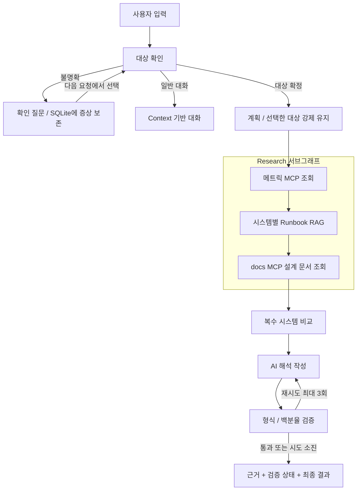

> BASE 장애 진단 프로젝트의 과거 기록입니다. 아래 실행 명령은 당시 기준이며, 보존 코드의 현재 실행 방법은 [보관 안내](../../../archive/README.md)를 확인하세요.

# 운영 장애 진단 Agent 개선 안내

> 서버 실행/응답 지연 문제를 수정했습니다. 최신 실행 방법과 진단 명령은 [STARTUP.md](STARTUP.md)를 먼저 확인하세요.

검증 결과는 [VALIDATION.md](VALIDATION.md), [fake 비교](../../../eval/results/fake/summary.md), [Ollama 실모델 비교](../../../eval/results/ollama/summary.md)에서 확인합니다.

## 빠른 실행

프로젝트 루트에서 실행합니다. `.env`의 실제 키는 Git에 올리지 않습니다.

```bash
cd /Users/hyeongjunhan/skala_mini_3_G104_hhj/all_total_vue_student
bash sh/setup_venv.sh
.venv/bin/python -m pip install -r requirements-dev.txt
bash sh/build_runbook_index.sh
bash sh/run_agent_fake.sh
```

새 터미널:

```bash
cd /Users/hyeongjunhan/skala_mini_3_G104_hhj/all_total_vue_student
bash sh/run_frontend.sh
```

브라우저에서 http://localhost:8600 에 접속합니다. fake는 API 호출 없이 제어 흐름을 검증하는 모드입니다.
실모델 시연에는 `bash sh/run_agent_ollma.sh` 또는 `bash sh/run_agent_openai.sh`를 사용합니다.
OpenAI 모드에서 발생하는 요청은 기존 `.env`의 키로 과금됩니다. Ollama는 `ollama serve`가 실행 중이고 사용할 모델이 설치되어 있어야 합니다. 기본 모델은 qwen3:0.6b / qwen3:8b입니다.

기존 서버와 포트가 겹치면 해당 서버를 직접 종료하거나 `PORT=18100`으로 별도 실행하고,
프런트엔드에도 `BACKEND_URL=http://127.0.0.1:18100`을 지정하세요.
새 스크립트는 다른 프로세스를 강제 종료하거나 `session.db`를 삭제하지 않습니다.

## 구현한 기능과 변경 파일

| 기능 | 구현 | 주요 파일 |
|---|---|---|
| 대상 확인 | 데이터 카탈로그의 정확한 시스템명만 사용. 미지정·미등록·알려진 대상과 미등록 대상 혼합 시 조사 전에 확인 질문. 선택 후 원래 증상을 이어받고 취소 가능 | `agent/nodes/targeting.py`, `agent/session_store.py` |
| 시스템별 RAG | 시스템별 알림을 별도 검색어로 사용. 다국어 dense embedding의 코사인 유사도로 runbook 검색. URI·유형·점수·모델 이름 보존 | `agent/retrieval.py`, `mcp_server.py`, `data/runbooks/index.json` |
| Research 서브그래프 | metrics → runbooks → service_docs 노드를 컴파일한 그래프를 메인 그래프의 research 노드로 연결 | `agent/nodes/research.py`, `agent/graph.py` |
| docs MCP 실제 사용 | 서버 탐색으로 `get_service_doc`을 찾아 시스템별 실습용 설계 문서를 조회 | `mcp_server_docs.py`, `data/service_docs.json` |
| 근거/추정 구분 | 사실은 Tool 반환값에서 직접 렌더링. 문서는 참고자료로, AI 보고는 원인 미확정 해석으로 구분. 근거 카드 제공 | `agent/nodes/reporting.py`, `web_chat.html` |
| 검증 실패 처리 | 최소 형식과 근거에 있는 백분율을 검사. 최대 3회 후 실패 상태 유지, 미검증 초안 비공개 | `agent/nodes/reporting.py` |
| 노드 모듈화 | 상태, 대상/계획, 조사, 분석/작성/검증/최종화 책임 분리 | `agent/state.py`, `agent/nodes/` |
| Context 압축 | 20개 메시지 초과 시 과거 사용자 발언을 발췌 요약하고 최근 6개 메시지 유지. 이름 진술 우선 보존. 원문 DB 보존 | `agent/session_store.py` |
| API/SSE 일치 | 두 경로가 동일한 실행·저장 함수를 사용. SSE에도 근거·메타데이터·Run ID 제공. 같은 thread의 동시 요청 직렬화 | `server.py` |
| 비교 평가 | 원본 v2 graph를 보존. 고정 데이터·동일 질의·동일 모델로 비교하고 JSON/CSV·LangSmith feedback 생성 | `agent/baseline_graph.py`, `eval/` |

Research의 전문 노드는 제한된 역할을 가진 워크플로입니다. 독립적으로 추론하는 LLM 세 개나 실제 로그 분석기를 구현했다고 주장하지 않습니다. 현재 데이터에 로그 원천이 없어 로그 분석 노드는 만들지 않았습니다.

## 구조



## 직접 확인할 시나리오

1. `billing-service 응답이 느려요` → 미등록 안내와 선택 버튼. 모니터링/계획 호출이 없어야 함.
2. 이어서 `cache-service` → 원래 증상으로 진단 재개. 메모리 매뉴얼과 cache 서비스 문서 표시.
3. 새 대화에서 `로그인 응답이 느려요` → auth-service를 임의로 선택하지 않고 확인 질문.
4. `payments-service랑 cache-service 공통 원인을 진단해줘` → 각각 CPU/메모리 매뉴얼, 각 시스템 docs, 원인 미확정 표시.
5. `gateway-service에서 payments-service로 요청이 타임아웃 납니다` → gateway 네트워크와 payments CPU 근거가 시스템별로 연결.
6. `web-01 상태 진단` → 관측 이상이 없으면 runbook을 강제로 배정하지 않음.
7. `auth-service-extra 장애 진단` → auth-service의 부분 문자열로 오인하지 않음.
8. 이름을 말하고 11턴 이상 대화 후 이름 질문 → 발췌 요약에 이름 진술 보존. 실행 정보에서 Context 문자 수 확인.

브라우저의 **새 대화**는 새 thread를 만들며, 기존 SQLite 기록은 삭제하지 않습니다.
페이지 새로고침 후 동일 thread는 유지되지만 화면의 이전 말풍선을 복원하는 기능은 이번 범위에 포함하지 않았습니다.

POST 확인:

```bash
curl -s http://localhost:8100/chat \
  -H 'Content-Type: application/json' \
  -d '{"message":"payments-service랑 cache-service 장애 진단","thread_id":"demo-multi"}' \
  | .venv/bin/python -m json.tool --no-ensure-ascii
```

SSE 확인:

```bash
curl -sN -G http://localhost:8100/chat/stream \
  --data-urlencode 'message=로그인 응답이 느려요' \
  --data-urlencode 'thread_id=demo-clarify'
```

## 테스트와 평가

```bash
.venv/bin/python -m pytest -q
.venv/bin/python eval/run_eval.py --backend fake --repeats 3
.venv/bin/python eval/run_eval.py --backend fake --repeats 3 --trace
.venv/bin/python eval/run_eval.py --backend ollama --repeats 1 \
  --case-ids cpu,multi-cpu-memory,unknown,missing,greeting --trace \
  --output eval/results/ollama
.venv/bin/python eval/compare_context.py
```

자세한 지표 정의와 주의점은 `eval/README.md`를 참조하세요.
테스트는 단위/그래프 테스트, 실제 ONNX 다국어 임베딩 검색, 실제 stdio MCP를 사용하는 API/SSE 테스트를 포함합니다.
브라우저 자동 테스트는 별도 선택 의존성(`requirements-browser.txt`) 설치 후 `python eval/browser_smoke.py --url http://localhost:8600`으로 실행합니다. macOS Chrome이 없으면 `playwright install chromium`이 필요합니다.
개발 과정에서는 Chrome headless로 확인 질문·선택·복수 시스템 결과·모바일 폭·JavaScript 오류도 검증했습니다. 캡처는 `eval/results/`에 있습니다.

## LangSmith에서 확인

- 실행 스크립트: `mini-project-fake-improved`, `mini-project-ollama-improved`, `mini-project-openai-improved`가 기본 프로젝트명입니다. 셸의 `LANGCHAIN_PROJECT`로 변경 가능.
- 평가: `--trace`를 붙이면 `mini-project-evaluation-{backend}` 프로젝트에 `eval.baseline`, `eval.improved` 실행과 세 지표 feedback을 기록합니다.
- `eval/results/{backend}/results.json`의 `langsmith_run_id`로 실행 식별. `summary.json`의 batch_id와 같은 metadata로 해당 평가 묶음 필터링.
- 개선 진단 트리: target.resolve → plan_node → research_specialists(metrics/runbooks/service_docs) → analysis/write/validate/finalize.
- 검색은 `runbook.vector_search`, docs는 `mcp.find_resource_template`와 `mcp.read_resource`에서 입력/출력 확인.
- UI **실행 정보**에 요청 Run ID, 경로, 검증 상태, Context 문자 수가 표시됩니다.
- **트레이싱 자체는 자동 채점이 아닙니다.** 평가 스크립트가 기대 출력과 비교한 뒤 feedback을 별도로 등록합니다.
- `.env`의 tracing/API key/endpoint가 유효해야 업로드됩니다. 로컬 테스트에서는 tracing을 끕니다.

## 결정과 한계

1. **로컬 다국어 임베딩 + SQLite 벡터 저장**: 6개 짧은 문서에 별도 벡터 DB 서버를 운영하는 부담을 피했습니다. 초기 모델 다운로드 약 0.22GB 및 로딩 시간이 필요합니다. 문서/검색 메타데이터/모델 이름이 달라지면 내용 해시로 재색인합니다. 문서가 커지면 청크 분할과 전문 벡터 검색기를 검토해야 합니다.
2. **검색 기준**: 기본 코사인 유사도 0.30 이상, 최고 점수와 차이 0.08 이내, 최대 2건. 임계값은 소규모 실습용이며 보편적 확률이 아닙니다. 다른 데이터셋으로 검증해야 합니다. 임계값 미달 시 임의 DB 장애 매뉴얼로 대체하지 않습니다.
3. **관측 중심 질의**: 시스템 간 증상 혼입을 줄이려고 시스템별 알림을 검색합니다. 모니터링에서 보이지 않는 사용자 증상은 추가 로그/지표가 필요하며 현재 검색에서 누락될 수 있습니다.
4. **발췌 압축**: 추가 LLM 호출 비용이 없고 재현 가능하지만 오래된 상세 맥락이 사라질 수 있습니다. 의미 요약 LLM은 사용하지 않았습니다. 문자 수/4 토큰 추정은 실제 토크나이저·청구량과 다릅니다. 기존 LLM 어댑터도 최근 10개 이력을 사용하므로 원문 전체 대비 감소율을 실제 비용 절감률로 해석하면 안 됩니다.
5. **검증 한계**: 형식과 백분율의 근거 포함 여부만 검사합니다. 시스템별 수치 교환, 인과관계, 모든 문장 사실성까지 검증하지 않습니다. 문서상 임계값과 현재 지표는 담당자가 구분해야 합니다.
6. **표본 한계**: 고정 모니터링·15개 평가 질의로 회귀를 확인합니다. fake의 점수는 모델 추론 품질이 아닙니다. 실제 모델은 비결정적이며 반복·보류 평가 사례를 늘려야 합니다.
7. **실습 서비스**: 실제 운영 모니터링, 조치 실행, 로그인/사용자 권한·멀티테넌트 보안은 구현 범위 밖입니다. docs의 서비스 관계/정책은 실습용으로 작성한 설계 자료입니다.
8. **속도 비교 주의**: 원본에는 병렬 효과를 보여주기 위한 태스크당 0.35초 지연이 있습니다. 개선 속도 차이를 RAG 도입 효과만으로 설명하면 안 됩니다. 초안 비공개로 최종 답변 체감 대기는 늘 수 있습니다.

## 참고한 자료

- 공유된 AI캠퍼스 AI Capstone 자료의 필요시 retrieval Tool 호출, Supervisor/Sub-agent 경계, 고정 Dataset 비교 원칙을 참고했습니다.
- AI Agent 설계 및 구축 자료는 이미지 기반 PDF로 표본 페이지를 시각 검토했습니다. 전체 OCR 분석을 수행했다고 주장하지 않습니다.
- [LangGraph 공식 Subgraphs 문서](https://docs.langchain.com/oss/python/langgraph/use-subgraphs): 컴파일된 서브그래프를 노드로 연결하는 방식.
- [FastEmbed 공식 지원 모델](https://qdrant.github.io/fastembed/examples/Supported_Models/): 다국어 ONNX 임베딩 모델 선택.
- [Sentence Transformers 다국어 모델 설명](https://sbert.net/docs/sentence_transformer/pretrained_models.html).

참고 PDF 원문은 저장소에 복제하거나 업로드하지 않았습니다.
